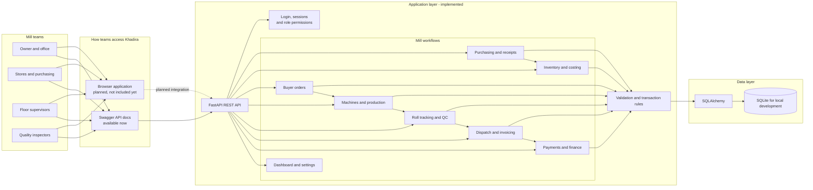

# Khadira Textile Mills ERP

Khadira is being built as a unified operations platform for a textile mill: one place to connect purchasing, stores, production, quality, dispatch, and finance. The goal is to replace disconnected registers and handoffs with traceable workflows and a consistent view of mill operations.

The current repository provides the platform's FastAPI backend. It does **not** yet include a browser frontend, so the implemented system is an API and is explored through its interactive API documentation. The architecture below shows the intended unified product while marking that missing interface clearly.

## Platform architecture



The connected workflow is intended to carry operational records forward: supplier receipts update stock, orders drive production, produced rolls move through inspection, and dispatch creates the financial records that office staff can reconcile. Each step is designed to preserve traceability rather than duplicate data across separate tools.

## What is implemented today

- **Access and roles:** login, sessions, and role-based permissions for admin, owner, store, floor supervisor, QC, and office users.
- **Purchasing and inventory:** supplier purchase orders, yarn receipts, stock movements, and inventory costing.
- **Orders and production:** buyer orders, machine records, production runs, and roll tracking.
- **Quality and dispatch:** quality inspection, finished-stock handling, dispatch, and invoice creation.
- **Finance and operations:** invoice payments, dashboard summaries, settings, and a database-backed health check.

Attendance and wage rules are described in [docs/business-rules.md](docs/business-rules.md), but attendance and payroll workflows are **not implemented in the API yet**. Likewise, the browser application shown as planned in the diagram is not part of this repository. This is a development MVP, not a production-ready deployment.

## Run the API locally

### Windows PowerShell

From the repository root:

```powershell
Set-Location backend
py -m venv .venv
.\.venv\Scripts\Activate.ps1
python -m pip install -r requirements.txt -r requirements-dev.txt
if (-not (Test-Path .env)) { Copy-Item .env.example .env }
```

Edit `.env` and set a unique `SECRET_KEY` before continuing. Then initialize local demo data and start the API:

```powershell
python -m mill.seed
python -m uvicorn app:app --reload --port 8000
```

### macOS or Linux

```bash
cd backend
python3 -m venv .venv
source .venv/bin/activate
python -m pip install -r requirements.txt -r requirements-dev.txt
cp .env.example .env
```

Edit `.env` to use a unique `SECRET_KEY`, then run:

```bash
python -m mill.seed
python -m uvicorn app:app --reload --port 8000
```

The seed command creates a local SQLite database and sample records. Demo accounts share the password `khadira2026!`; use them only for local development. Never expose the seeded setup or development secret to the public internet.

## Explore the API

With the server running at `http://127.0.0.1:8000`:

- Interactive API reference: [http://127.0.0.1:8000/docs](http://127.0.0.1:8000/docs)
- ReDoc reference: [http://127.0.0.1:8000/redoc](http://127.0.0.1:8000/redoc)
- Health check: [http://127.0.0.1:8000/api/health](http://127.0.0.1:8000/api/health)

The health check runs a database query and returns `503` if the configured database is unavailable.

| Role | Username |
|---|---|
| Administrator | `admin` |
| Owner | `owner` |
| Store keeper | `store` |
| Floor supervisor | `floor_supervisor` |
| QC inspector | `qc` |
| Office staff | `office` |

## Run tests

From the repository root:

```powershell
Set-Location backend
python -m pytest tests -v
```

The suite covers authentication and the main purchasing, inventory, order, production, quality, dispatch, and finance flows.

## Design principles

- Financial amounts use integer paise to avoid floating-point rounding.
- Yarn stock is measured in grams; fabric length is measured in centimetres.
- Stock changes and dispatches use database constraints and transactions to prevent negative stock and duplicate roll dispatch.
- Production and costing records preserve the input-cost snapshot used when material is issued.
- SQLite is the configured local development database. Production database, security, deployment, and frontend choices still need environment-specific validation.
